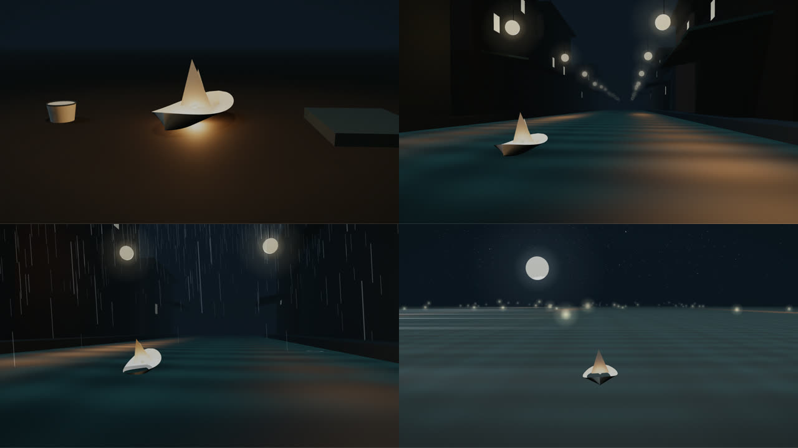

# The Paper Boat

A 75-second film that plays from one HTML file. A sheet of paper folds into a
boat on a wooden table, drops into a night canal, sails past lanterns, crosses
a storm, runs a drain, and comes out onto the open sea, where it flattens back
into a page. Then it loops.

- One file. No images, models, fonts or sound files. Every shape, colour and
  note is made by code when the page loads.
- No network. It runs from disk.
- One score. The same note list feeds the synthesiser and the picture, so every
  fold, swell and lantern pulse lands on a beat.



## Watch it

Download `index.html` and open it in a desktop browser with WebGL 2. Click once
to begin with sound.

| Input | Action |
| --- | --- |
| Click or tap | Start, and answer the scene |
| `Space` | Pause and resume |
| `R` | Restart from the table |
| `P` | Woodblock print grade |
| `M` | Mute |
| `←` `→` | Jump five seconds |

## The score moves the picture

96 BPM, 30 bars, 75 seconds. `src/02_score.js` holds the note list and the cue
times. Everything on screen asks it for time.

| Sound | What it moves |
| --- | --- |
| Wood block | The four folds of the sheet, and the seal at the end |
| Kalimba | The tune, and the boat's bob on the water |
| Marimba | Droplets on the canal, and the small rings on the surface |
| Bass | The width of the water and the lift of the swell |
| Taiko | The storm, the camera shake, and the rain |
| Bell | Lanterns on the sea, and the moon's halo |
| Sip, splash | The paper leaving the table and hitting the canal |

## How it is put together

Source lives in `src/` as plain scripts, concatenated in file-name order inside
one IIFE.

```
python3 tools/build.py
```

That inlines `vendor/three.iife.js` and every source into `dist/paper-boat.html`
and copies the result to `index.html`.

| File | What it makes |
| --- | --- |
| `00_util.js` | Maths, easing, seeded random, palette |
| `02_score.js` | The note list, cue times, and the queries the picture asks |
| `04_world.js` | Renderer, scene, lights, materials |
| `05_glow.js` | Glow textures drawn on a canvas, key light, shadow blob |
| `10_paper.js` | The sheet, the four folds, the sail, the lantern |
| `12_water.js` | Water shader: a gutter and the open sea from one shader |
| `14_street.js` | The table set, then the canal street and its lanterns |
| `16_rain.js` | Instanced rain streaks and rings on the water |
| `18_tunnel.js` | The drain, its ring lights and the bright mouth |
| `20_sea.js` | Moon, stars, hills, floating lanterns |
| `30_camera.js` | The boat's path and the shot list |
| `40_audio.js` | Kalimba, marimba, bass, block, taiko, bell, noise beds |
| `50_film.js` | The director: one time value drives the whole film |
| `60_main.js` | Boot, clock, keys, render loop, still-frame mode |

### Rebuilding the library bundle

`vendor/` holds three.js r180 and a small IIFE bundle. To rebuild the bundle:

```
npx esbuild vendor/entry.js --bundle --format=iife --global-name=THREE \
  --minify --outfile=vendor/three.iife.js
```

`vendor/entry.js` is one line: `export * from './three.module.js';`

### Checking a single frame

The page takes a few query flags, which is how the stills were made:

```
index.html?still=1&t=40      # hold one frame at 40 s
index.html?debug=1           # show errors on the page
index.html?off=water,rain    # hide layers
```

```
"/Applications/Google Chrome.app/Contents/MacOS/Google Chrome" \
  --headless=new --window-size=1280,720 --enable-unsafe-swiftshader \
  --screenshot=out.png "file:///path/to/index.html?still=1&t=40"
```

## Known limits

- One quality level. There is no LOD, so a weak GPU will drop frames.
- The film is built for a desktop viewport. It runs on a phone, but the shots
  are framed for 16:9.
- Sound needs a click first. Browsers do not allow audio before that.
- The paper boat is a stylised bend, not a real origami sequence. Four moves,
  not forty folds.

## Licence

MIT for the film code. three.js is MIT, and its licence text is in
`vendor/LICENSE`.
